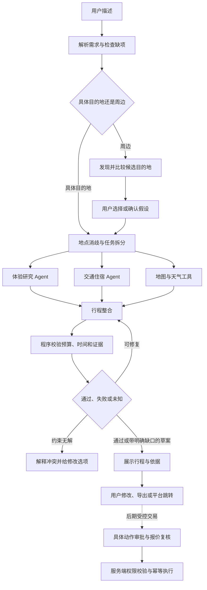

# travel-agent：总体开发计划

最后更新：2026-11-09（Asia/Shanghai）

## 1. 规划的目标与当前阶段

先做国内旅行的可信规划，再逐步接入预订。每个阶段都留下可复查的代码、示例、证据和验证结果。

当前已完成 M1 和 M2 受控单 Agent 草案基线，DeepSeek 工具调用、搜索与高德地图已串联真实验证。尚未完成原文事实核验、完整旅行覆盖、多 Agent 或上线。本文后续架构、数量和指标，除用户已确认需求外，均为待验证的工程方案。

2026-11-08 用户新增发布要求：正式上线前，冒烟、回归及全量适用测试全部运行并通过。具体层次和阻塞规则见 [测试门禁](docs/TESTING.md)。当前离线测试不代表真实集成或正式发布验收。

状态标记：`[x]` 表示该项产物已经完成；`[ ]` 表示尚未完成。某项文档完成不代表所描述的功能已经实现。

## 2. 最小可用版本做什么

### 2.1 用户能完成的闭环

1. 输入具体目的地或周边范围，以及预算。
2. 补充会改变结果的关键信息：出发地、日期/时长、人数、预算口径、交通和偏好。
3. 对周边请求先比较 3 个左右候选目的地；候选不足时如实展示，不补造。
4. 并行研究体验、交通和住宿，合并为一份逐日行程。
5. 查看费用明细、交通时间、来源、抓取时间、待确认项目和替代安排。
6. 修改“少走路”“更便宜”“换一家餐厅”等需求，生成新版本并显示变化。
7. 导出行程或进入官方/供应商页面，由用户完成预订。

### 2.2 首版范围

- 国内中文，人民币；南京、上海及周边作为首批测试样例，不硬编码为仅能服务这两地。
- 单城或单一周边目的地，优先 1～3 天短途；多城和国际旅行后续扩展。
- 正式路线需要明确日期、人数、出发地和预算口径；缺项允许输出明确标注假设的灵感草案。
- 先接地图和一个国内搜索源，并支持用户主动导入攻略文本及链接。链接不能读取时允许粘贴内容。
- 用户导入信息同样需要来源和可信标签，不因“用户提供”自动成为已核实事实。
- 只读与跳转。没有真实报价权限时，交通住宿显示估算和查询入口，不承诺余票或可订。

### 2.3 后续范围

- 多平台内容融合、用户长期偏好、多人协作、复杂多城、国际来源。
- 授权库存、实时报价、订单管理及带审批的交易。
- 在证据量确实需要时增加向量检索；在约束复杂到简单算法不足时引入求解器。

### 2.4 产品形态：网站先行，多端按需求扩展

2026-11-08 用户提出需要明确网站、页面、App 的产品路线，并同意继续。当前规划采用“响应式 Web 应用先行”，不是只做一个展示页面，也不同时维护所有客户端。以下为工程方案，后续按用户反馈调整。

**第一阶段交付一个网站，包含多页面工作台。** 一个网址可在电脑和手机浏览器使用。电脑侧重点是比较目的地、查看地图和详细证据；手机侧重点是快速输入、查看逐日行程、导航和行中修改。两种布局共用后端、身份和行程数据。

| 形态 | 何时做 | 主要收益 | 代价和边界 |
| --- | --- | --- | --- |
| 响应式网站/Web 应用 | M4 主交付物 | 无需安装，便于分享行程链接；一份前端覆盖电脑和手机浏览器。 | 必须单独测试触屏、窄屏、弱网和浏览器差异；“适配手机”不等于原生 App。 |
| 单个页面 | 作为早期交互原型或网站内部页面 | 可迅速验证输入和结果布局。 | 一个静态页面不能承担账户、持久化任务、版本与审批全流程，不作为最终产品定义。 |
| PWA（可安装的渐进式 Web 应用） | M4 基础流程稳定后，按行中需求增加 | 在支持的浏览器添加到主屏；缓存明确选择的行程摘要，方便弱网查看。 | 浏览器/系统支持不同；缓存不是实时数据。报价、支付、审批、身份信息不做离线放行。 |
| 微信等小程序 | M7，出现明确的微信分享、入口或留存需求后 | 适应国内常用分享场景；可提供精简行中视图。 | 新增平台审核、域名/能力限制和独立测试。不能假定 Web 页面原样运行或自动得到平台数据权限。 |
| Android/iOS App | M7，原生能力或留存数据证明有必要后 | 深度设备集成、平台通知及更完整行中体验。 | 安装分发、系统权限、原生模块、平台差异和维护成本更高；先用小范围原型验证。 |

**为什么先做网站。** 当前最大不确定性是来源可用性、规划质量和用户到底省多少时间。Web 能先验证这些核心价值，避免同时维护多个客户端。路线不排斥 App；后端从开始就提供版本化 API，使后续客户端复用服务。

**进入其他端的条件。** 记录手机访问比例、行中使用频次、用户安装/通知诉求和弱网失败情况。Web 的能力确实无法满足关键场景，并且收益足以支撑额外维护时，再立项 PWA、小程序或 App。阈值在 M4 有真实使用基线后制定，不先承诺全平台发布日期。

### 2.5 网站页面与交互边界

| 页面/区域 | 用户完成的工作 | 必须可见的结果 |
| --- | --- | --- |
| 新建旅行 | 输入地点、预算、日期、人数、偏好；补全关键信息。 | 原文与结构化条件，未确认项及费用口径；明确允许生成草案。 |
| 候选目的地 | 周边请求比较交通、费用区间和体验。 | 选择原因、证据、缺口；用户选择后再精查对应路线。 |
| 规划工作台 | 查看进度、逐日时间线、地点地图、费用及来源。 | 草案/已确认条件、来源获取时间、估算/未知状态和数据源失败。 |
| 修改与版本 | 局部替换餐厅、减少步行、降低预算，比较版本。 | 哪些条件和安排改变、哪些检查需要重跑；不能覆盖用户已确认的约束。 |
| 我的旅行/详情 | 找回行程、查看历史版本、导出和导航跳转。 | 默认私有；用户主动分享时生成可撤销的最小公开视图，不包含个人资料。 |
| 审批与订单 | M6 后才出现；查看具体预订动作、报价及退改条件。 | 独立的动作与付款确认、失效状态、执行结果；首版不展示可点击的假购买按钮。 |

手机端采用分区切换或抽屉，避免同时挤入地图、对话和证据三列。桌面可用并列视图。无论屏幕大小，来源、预算和待核实提示都不能因空间缩小而消失。

### 2.6 对应技术栈与目录规划

以下是选型方案，不代表已安装或实现。版本在对应阶段核对官方文档、验证兼容并写入锁文件；不机械使用聊天中提及的“最新版本”。

| 层 | 技术路线 | 使用方式与选择理由 |
| --- | --- | --- |
| Web 前端 | TypeScript、React、Next.js App Router，Node.js LTS、pnpm | M4 在 `web/` 建立多页面应用；组件化构建电脑/手机布局。Next.js 用于页面和服务端渲染，不另写一套规划引擎。 |
| 样式与交互 | Tailwind CSS；按需采用 Radix/shadcn 组件；React Hook Form + Zod | 复用无障碍交互基础、统一表单反馈。前端校验提升体验，服务端 Pydantic 校验仍为最终边界。 |
| 接口和异步状态 | FastAPI OpenAPI 生成 TypeScript 契约；TanStack Query；HTTP + SSE（服务器向浏览器推送进度） | 初期可轮询任务；需要实时进度再接 SSE。状态在服务端保存，刷新页面可以恢复；取消请求有独立接口。 |
| 地图 | 高德 Web 地图组件/JS API（获取相应权限后） | 前端展示点位，后端统一核验地点和路线；区分浏览器可见 Key 与仅服务器持有的密钥，不把所有 Key 混为一种。 |
| 后端 | Python、FastAPI、Pydantic、uv | M1 已实现基础。`src/travel_agent/` 保持领域逻辑，前端不复制预算和审批规则。 |
| 模型 | 初始阶段仅 DeepSeek，服务端适配器 | 用户 2026-11-08 明确只提供 DeepSeek；不为首版引入豆包、GLM 或其他模型账号依赖。模型名可配置，真实能力用账号验证。 |
| Agent 与任务 | M3 优先验证 LangGraph；单独工作进程承载长任务 | Web 请求创建任务后返回 ID；不能把长时多 Agent 工作只放在网页请求生命周期里。按实际并发需求再引入任务队列，不提前搭集群。 |
| 数据 | SQLite 本地验证；公开多用户服务采用 PostgreSQL、数据库迁移 | 行程版本、来源、任务、身份关联和审批持久化；并发更新使用版本/事务。Redis 仅在队列或共享配额确有需要时增加。 |
| 身份与权限 | 同源安全会话、服务端用户/资源授权，HttpOnly/Secure Cookie 与 CSRF 防护 | M4 对外试用前实现；页面登录不代替后端逐资源授权。具体身份供应商届时决定，不承诺某一国内登录方式已经可用。 |
| 部署 | Docker、同源反向代理（Nginx 或 Caddy）、HTTPS、私有运行存储 | 前端 `/`，后端 `/api`，工作进程独立；开发/预发布/生产分离。国内优先评估实际访问、地图和供应商连通性，托管商/地域/域名及实际备案要求在部署前核实，不先绑定特定海外托管。 |
| 前端测试 | TypeScript/ESLint、Vitest、React Testing Library、Playwright | 覆盖表单与组件、桌面/手机端到端、断线恢复、修改及来源展示；真实目标手机补真机验收，不能只靠模拟视口。 |
| 后端与发布测试 | 现有 pytest、Ruff、统一检查；后续集成、安全、负载和预发布检查 | 沿用用户要求的冒烟、回归、全量门禁。依赖/镜像检查与生产只读冒烟加入发布记录，工具在对应阶段确定。 |
| PWA/原生/小程序 | PWA Manifest + Service Worker；App 候选 React Native/Expo；小程序候选原生或 Taro | 均为后期候选。可复用 API、类型和部分业务逻辑，不承诺不同平台 UI 代码完全共享；单独评估深链、通知、缓存与交易权限。 |

参考官方能力说明：[Next.js App Router](https://nextjs.org/docs/app)、[PWA](https://developer.mozilla.org/en-US/docs/Web/Progressive_web_apps)、[React Native](https://reactnative.dev/docs/getting-started)。技术选择的理由是本项目判断，不是文档对本项目效果的保证。

当前目录保持 Python 包结构；M4 新增 `web/` 和前端锁文件即可，不为尚未开发的客户端生成空工程。共享契约来自后端 OpenAPI。每个新端都必须通过独立测试，不因共用后端自动算验收通过。

## 3. 先固定输入与输出契约

### 3.1 输入对象

| 对象 | 最少字段与规则 |
| --- | --- |
| `TripRequest` | 用户原文、出发地、目的地条件、日期或时长、成人/儿童人数、预算、交通方式、兴趣、节奏、无障碍需求、已确认项、假设和待补项。 |
| `DestinationSpec` | `mode=exact/nearby`、原始地名、地图实体/行政区编码、周边中心、半径或单程耗时、允许的交通方式。具体地点不强行提升为整个城市。 |
| `BudgetSpec` | 原文、`currency=CNY`、`kind=ceiling/target/range`、目标/区间/上限金额、金额单位为分、总额/每人/每天、费用包含项、确认状态。 |

预算语义沿用 [AGENT.md](AGENT.md) 第 4 节。单值不直接当成必须花完；范围下限默认是偏好，下限严格性可修改。

### 3.2 输出对象

| 对象 | 职责 |
| --- | --- |
| `SourceRecord` | 来源、URL/内容 ID、查询词、查询排序、获取时间、发布时间（可空）、内容类型、许可/留存信息、必要摘录定位。 |
| `EvidenceClaim` | 具体主张、证据 ID、适用日期、原始/派生关系、已核实/估算/待核实/冲突状态及简短理由。 |
| `PlaceCandidate` | 地点实体、坐标系、地址、类别、推荐原因、适用人群、证据和待核实项。国内地图坐标不能混用而不转换。 |
| `CostItem` | 金额或区间、币种、计价单位、人数/房间/晚数、税费、来源、是否估算、报价有效期。未知值为空，不能用 0 代替。 |
| `Itinerary` | 版本、逐日时间块、地点、交通段、用餐/休息、成本、来源、冲突、假设、替代项和整体状态。 |
| `ValidationReport` | 每项规则的通过/失败/未知状态、冲突原因、预算区间和无法验证的原因。 |
| `ApprovalRequest` | 后期交易动作、用户、方案版本、供应商报价、不可变参数哈希、有效期和动作状态。 |

来源状态不能只写一个模型自评置信度。需要让用户知道“凭什么”和“哪里还不确定”。

## 4. 架构与任务依赖

### 4.1 工作流

重规划有次数和成本上限。不能在无解约束之间无限循环，也不能把“未知”自动算作“通过”。

### 4.2 最小角色分工

| 角色 | 任务 | 执行条件 |
| --- | --- | --- |
| 协调与需求解析 | 解析输入、检查缺项、安排任务、聚合状态。 | 每次运行；确定性路由优先，必要时使用模型。 |
| 目的地发现 | 生成周边候选并解释预算和通达性差异。 | 仅周边或开放目的地请求。 |
| 体验研究 | 检索景点、美食、玩法和近期反馈，输出带证据候选。 | 地点范围就绪后，与交通住宿研究并行。 |
| 交通住宿研究 | 交通、住宿区域、报价或估算，以及数据缺口。 | 起终点、日期和人数足够明确；缺项只给粗略建议。 |
| 行程整合 | 在偏好与约束内选择候选，安排逐日活动，解释取舍。 | 研究结果汇合后；不得覆盖用户硬约束。 |
| 校验与复核 | 程序计算硬约束；可选模型检查证据遗漏和叙述矛盾。 | 输出前；模型不能替代程序权限检查。 |

首版角色可以合并在一个图和进程中，不按 Agent 数拆微服务。只有独立、输入就绪的节点并行。平台连接器供多个角色复用，来源/账号配额在连接器层统一控制。

### 4.3 暂定技术路线

| 层 | 首选验证方向 | 选择依据/改动条件 |
| --- | --- | --- |
| 后端和领域结构 | Python、FastAPI、Pydantic | 先把结构化数据、规则和 API 边界做清楚。版本在 M1 安装时核验并锁定。 |
| Agent 编排 | LangGraph | 重点验证并行汇合、状态持久化和人工中断；Google ADK 保留为备选。见 [ADR-0001](docs/decisions/0001-evidence-first-workflow.md)。 |
| 模型 | 初期仅 DeepSeek，独立服务端适配器 | 用户已明确本阶段供应商；模型标识可配置。其他模型后期评估，首版不要求其他模型密钥。 |
| 搜索 | 独立 `SearchProvider` 适配器 | 优先验证 DeepSeek Search & Fetch 的实际账号能力；模型调用成功不代表搜索已开通。其他搜索来源按权限后补。 |
| 地理和路线 | 高德官方 Web 服务或 MCP | 核对地点实体、路线和城市周边；优先选择错误处理和测试更稳定的接入形式。 |
| 数据与恢复 | 本地 SQLite 起步，服务化再评估 PostgreSQL | 领域数据、事件和检查点分开建模；运行状态可恢复，不依赖进程内内存。 |
| 约束 | 普通程序规则起步，OR-Tools 后续评估 | 简单路线先可解释；复杂时间窗、多日选择问题再采用求解器。 |
| 留痕 | 结构化事件与本地存储起步 | 需要集中追踪后再评估 Langfuse；保留供应商无关字段，不把日志绑定某家云。 |
| 界面 | M1/M2 CLI 验证；M4 响应式 Web 主产品 | Next.js/React/TypeScript，电脑与手机不同布局共享业务服务；多端路线见第 2.4～2.6 节。 |

暂不复制整套旅行 Demo，也不同时引入多个 Agent 框架。M0 没有确定任何业务依赖版本。

### 4.4 工具契约与失败处理

- 工具适配器统一暴露：输入结构、能力和权限、输出证据、分页状态、错误类型、耗时及计费元数据。
- 来源能力登记区分：文档已确认、账号已开通、真实调用已通过、生产可用。当前只有公开资料核验。
- 401/403 等鉴权/权限错误返回明确缺口；429 限流与临时超时按供应商规则做有限退避；不能无限重试或自动绕过限制。
- 每个平台设独立并发/速率限制；同一事实查询在允许范围内缓存和合并，避免多个 Agent 重复计费。
- 单个来源失败时返回部分结果、失败来源和受影响主张；不静默用模型记忆补齐。
- 外部 URL 读取限制协议、重定向和内网地址，避免 SSRF（通过服务端请求访问内部资源）；外部内容不能升级工具权限。
- 模型结构化输出必须经过本地校验。允许有限纠错；仍无效时停止该分支并说明。
- 每次运行预算分开管理：用户旅行预算，以及模型/搜索调用的服务成本。

## 5. 平台总结与 TOP N 的处理

这部分决定怎样利用已有平台 AI，避免重复处理和失去证据。

1. **先判断拿到了什么。** 记录原始搜索结果、片段、全文、平台总结或带引用回答，不能混为一类。
2. **可以直接复用什么。** 带引用且可追到来源的总结，可作为研究中间产物；泛化灵感可展示为平台观点。
3. **必须回到来源的内容。** 进入行程的店铺身份、营业、预约、票价、库存、交通和退改条件，需要对应原始或权威证据。没有权限就标未知。
4. **分两段取数。** 初始参数建议每个主题召回 10～20 条元数据/摘要，去重重排后读取 5～10 条较相关内容；这些数是待实验参数，不是已证实最优值。
5. **按缺口扩展。** 覆盖不足、明显冲突或偏好未满足时，再翻页到最多 50 条候选或配置上限。权限、配额和服务预算优先；平台可返回数量较少。
6. **保留多样性。** 不只按点赞排序；结合地点匹配、时间、独立作者、内容重复、广告迹象和负面反馈。不能把热度当可靠性。
7. **保存可复查范围。** 记录查询词、排序、时间、候选数、已读数、去重和排除原因。派生摘要关联底层来源，不重复计算为独立证据。

对比实验至少包含“只用平台总结”“原始 TOP10”“原始 TOP50”“分批扩展”四组。使用相同需求、来源快照和可用权限，比较关键事实正确性、覆盖、耗时、成本及引用可定位率。

## 6. 分阶段任务树

### M0：调研与项目基线

- [x] 建立 `AGENT.md` 和 `AGENTS.md` 入口。
- [x] 建立总体计划、研究记录、首份架构决定、开发日志与变更记录。
- [x] 调研代表产品、开源样例、国内搜索与地理工具，并标注核验程度。
- [x] 初始化本地 Git，并设置提供的 GitHub 仓库为 `origin`，使用已确认可访问的 HTTPS。
- [x] 检查文档链接、忽略规则和提交差异，将文档基线提交并推送到 `origin/main`。
- [ ] 真机试用主要竞品并按同一请求比较体验。留在后续调研，不以官网宣传代替实测。

阶段产物：当前仓库文档。文档基线完成；接口可用性、竞品优劣和多 Agent 收益仍未证实。

### M1：输入规则与离线领域层

目的：先让系统准确理解需求、算清金额，避免后续 Agent 建立在错误条件上。

- [x] 初始化后端结构、隔离环境、锁文件、开发说明和基础持续集成配置；远端运行结果单独核验。
- [x] 实现目的地类型、预算、需求、证据、费用和校验结果的数据结构。
- [x] 实现预算文本规范化；支持范围分隔符、人民币单位和硬/软约束，保留原文。
- [x] 实现缺项检查、无效输入和约束冲突报告；地点实体均待 M2 核实，当前输入输出保持草案状态。
- [x] 建立 20 条固定预算/目的地样例，不用真实个人资料或虚构实时来源；其他阶段样例随功能补充。

验收：

- “5000以内”“2000元”“2000~3000”“2000～3000”“每人2000”均得到符合既定语义的结构。
- 南京、上海、南京附近、上海周边分别进入正确路径；具体地点与同名地点可以保留待消歧状态。
- 缺少人数或预算口径时不能输出伪精确总价；负数、颠倒区间和不支持币种有明确结果。
- 预算单元测试覆盖人数、房间/晚数、单位、税费、未知成本和预备金，不用模型完成加减。
- 离线检查无需平台密钥即可运行。

### M2：真实只读接口验证与单 Agent 基线

依赖：M1；配置一个国内模型和必要的搜索/地图账号。正式调用前确定每次运行服务成本上限。

2026-11-08 用户明确：每次规划服务调用最多 2 元；高德仅用免费配额，耗尽停止，后续需要时另行购买。当前实现保守费用预留、调用上限和未知费用停止，不等于供应商侧账单封顶。高德本地免费模式不能代替控制台关闭付费回退。

- [x] 增加 DeepSeek 官方主机适配、环境配置、一次请求上限、JSON 本地校验、统一安全错误码和候选字段提取 CLI；模拟协议测试加入默认全量入口。
- [x] 使用用户提供的密钥完成真实候选字段提取及 CLI 验证；最终调用输入 202、输出 17 tokens。该项不覆盖工具调用、搜索、地图及完整行程质量。
- [x] 实现 DeepSeek Search、高德地点/周边/步行适配及只读来源 CLI；模拟协议、空/部分结果和安全错误加入全量测试。
- [x] 完成一次公开通用查询的真实搜索，返回链接及 UTC 获取时间；搜索摘要不标为已核实原文。
- [x] 实现 SQLite 最小来源索引，保留查询哈希、来源定位、结果哈希和状态；不等于正文快照或完整重放。
- [x] 使用用户本地配置的高德 Web 服务 Key 真实验证地点、周边和步行；3 次调用均返回有效结果，单位和来源索引检查通过，不据此确认营业/票务事实。
- [x] 来源模块本地全量 185 项通过，覆盖率 98.64%；实现提交 `3b273bd` 的 Windows/Linux × Python 3.11/3.13 四组远端 CI 全部通过。实际模型/地图查询与离线矩阵分开留痕，均不代表已通过完整产品上线门禁。
- [x] 实现受控 DeepSeek 工具回合、白名单与本地参数校验；每次最多 4 次模型、5 次来源调用及费用预留账本，未知价格/用量停止。
- [x] 实现有来源的单城 1～3 天草案、地点与引用片段检查、时间/路线衔接、未知旅行预算报告和 Markdown/JSON 输出。
- [ ] 补齐原文内容核验、许可范围内可重放证据、并发/恢复下原子费用账本及供应商实际账单对账。当前引用检查不等于完整事实核验。

- [x] DeepSeek 工具调用与结构化提交完成真实验证；超时、错误、权限及调用上限有离线回归。当前任务截止时间依赖步骤检查和 HTTP 超时，强制后台中断留待任务系统。
- [x] 接入高德及 DeepSeek 搜索；来源字段、模拟错误样例和真实调用状态已验证。
- [ ] 在来源许可范围内建立真实脱敏响应快照与重放；当前最小来源索引不能代替原文快照。
- [x] 用户授权资料快照、完整性校验、离线定位重放与删除；不替代真实平台响应快照。
- [ ] 若提供了知乎或抖音权限，验证对应官方搜索；无权限不阻塞基础闭环。
- [x] 实现正文/摘要/链接导入，明确 `user_text/search_snippet/link_only`，模型共享和保存独立授权，增加无状态检查 API。
- [ ] 接入经许可的网页正文获取，记录失败/摘要/成功状态；粘贴正文不能算站点真实抓取成功。
- [x] 建立独立 DeepSeek Fetch 适配器与 CLI，仅两个精确审查网址；两页真实读取和正文引文定位通过，默认只留元数据。此项不替代来源认证、许可核查或规划集成。
- [x] Fetch 本地统一检查全量 306 项通过，语句与分支合并覆盖率 98.07%；wheel/sdist 构建、独立环境 CLI/模拟读取/审计和归档隐私检查通过，真实调用与离线验证分开记录。
- [x] Fetch 实现提交 `d2c236e` 的 Windows/Linux × Python 3.11/3.13 四组远端 CI 全部通过；[运行记录](https://github.com/s1ty0/travel-agent/actions/runs/42476156880)。读取成功不替代完整规划与事实核验。
- [x] 将网页读取按 `page_urls` 显式范围接入单 Agent，共享整次规划 2 元账本、来源工具次数和剩余超时；默认关闭，正文保持未核实证据类型。
- [x] 规划内读取的缓存、失败停止、上下文上限和最小审计已实现；一次真实正文到草案引文闭环通过，2 次模型、3 次来源，10093 毫秒，费用上界估算 0.025660 元，事实仍未核实。
- [x] 规划内 Fetch 本地全量 335 项通过，语句与分支合并覆盖率 97.91%；wheel/sdist 构建、独立安装环境的完整模拟规划/CLI 门槛/共享账本和归档隐私检查通过。
- [x] 规划内 Fetch 实现提交 `019d4e3` 的 Windows/Linux × Python 3.11/3.13 四组远端 CI 全部通过；[运行记录](https://github.com/s1ty0/travel-agent/actions/runs/42491103814)。来源身份、语义和时效核验仍未完成。
- [ ] 完成来源身份独立证明、主张与正文的语义支持/否定/例外核查、发布日期与出行日适用性；采集成功或域名后缀不算事实核验通过。
- [x] 首版预约主张分层检查：身份档案与实际归属分开、完整段落有限语义、明确文字日期与活动日比较，提供离线检查 API 和最小审计；不能解释的条件保留未知，不提供自动事实认证。
- [x] `reservation-rule-v1.1` 的同版本真实正文正反复验通过；修正提示词过严拦截，保留旧报告。该机制不替代独立机构身份、完整语言理解或当日规则认证。
- [x] 本轮本地全量 378 项通过，语句与分支合并覆盖率 98.08%，含 54 条固定回归；本轮合成样例已用于开发，不当作独立保留集。
- [x] 首版预约核查 wheel/sdist、独立安装的离线 API/正反规则/模拟规划及最小审计通过，构建归档和文档链接检查通过；仍未完成独立事实认证和上线验收。
- [x] 修正后提交 `37aeb48` 的 Windows/Linux × Python 3.11/3.13 四组 CI 全部通过，包含文档 Python 示例格式和全量测试；[运行记录](https://github.com/s1ty0/travel-agent/actions/runs/42548188749)。首次文档格式失败及修正过程另行保留。
- [x] 针对旧失败邮件再核对 main `3c404b7`，四组 CI 全部通过；继续补齐未暂存 Markdown 自动格式发现及四项真实回归，本地全量 382 项通过，不关闭任何门禁。
- [x] 文档防漏检实现 `9947fa2` 的 Windows/Linux × Python 3.11/3.13 四组 CI 全部通过，含新增回归和构建；[运行记录](https://github.com/s1ty0/travel-agent/actions/runs/42549518825)。旧失败邮件不代表当前版本仍失败。
- [x] 单 Agent 可引用明确共享资料，程序定位引文并报告声明日期；未共享、缺失、重复歧义或只有链接不能通过正文引用校验，仍不认定事实真实。
- [x] 增加 10 条合成证据重放回归；已有 20 条输入回归继续运行。合成回归已用于开发，不当作独立保留集。
- [x] 本轮资料实现的本地全量 259 项、覆盖率 97.97%、wheel/sdist 和独立环境 CLI 安装验证通过。两次新增真实规划均为 `invalid_plan`，一次明确交通间隔不足；不能记为真实规划生成验收通过，见当次开发日志。
- [x] 资料实现提交 `76910e8` 的 Windows/Linux × Python 3.11/3.13 四组远端 CI 全部通过；[运行记录](https://github.com/s1ty0/travel-agent/actions/runs/42466599194)。这不解除真实事实、完整规划及上线阻塞。
- [ ] 实现小批检索、去重、地点消歧和证据归档；形成统一适配器契约。
- [x] 首版预约跨资料比较：检查全部已授权可用正文，规范文本/声明网址/主机候选关联，保留版本、区分文字时段和冲突，不按多数票或引用数量认定独立证明。
- [x] 比较已接入离线 API、规划输出和最小审计，设置 32 来源版本/每源 20 规则组合边界；截限或同 ID 多版本提示未完整完成。真实跨来源效果与独立来源认证仍未完成。
- [x] 跨资料比较本地全量 407 项通过，语句与分支合并覆盖率 98.02%；构建、独立安装的冲突检查/快照重放/模拟规划和归档隐私验证通过，没有新增付费调用。
- [x] 跨资料比较实现 `a3caa2a` 的 Windows/Linux × Python 3.11/3.13 四组 CI 全部通过；[运行记录](https://github.com/s1ty0/travel-agent/actions/runs/42561748619)。真实跨来源事实质量仍未验收。
- [x] 实现一个调用相同工具的单 Agent 串行基线，真实跑通需求到带来源的两地点草案；尚不覆盖全部旅游需求或原文事实核验。
- [x] 基线实现提交 `59d4607` 的本地全量 219 项、覆盖率 97.85%，Windows/Linux × Python 3.11/3.13 四组远端 CI 全部通过；真实运行 4 次模型、5 次来源、约 6.5 秒，费用上界估算 0.032690 元，旅行费用仍未知。
- [ ] 记录国内访问、延迟、分页、配额、调用成本和数据新鲜度，更新研究矩阵。

验收：

- 至少一条真实查询完成“结果 URL/ID、获取时间、可定位主张”的闭环。
- 地点与路线使用真实查询结果；可复现的快照重放与实时运行明确区分。
- 无权限、空结果、限流、过期信息和抓取失败都有可见状态。
- 未接票务/酒店库存时，输出不包含“确认有票”“确认可订”等承诺。
- 基线保留运行事件、耗时、调用次数和费用，为 M3 提供对照。

### M3：多 Agent 与行程约束

依赖：M2 真实证据闭环及可重放基线。

- [ ] 使用 LangGraph 验证任务状态、分支并行、结果汇合、取消和恢复。
- [ ] 增加体验与交通住宿研究分工；周边请求增加候选目的地发现。
- [ ] 实现逐日安排、就餐/休息和必要交通缓冲；可用数据不足时保留未知状态。
- [ ] 实现预算区间、时间重叠、营业时间窗、交通衔接、必去/禁忌和证据完整性检查。
- [ ] 实现有限重规划，遇到硬约束冲突返回原因和替代选项。
- [ ] 对同一数据与模型预算比较单 Agent、多工具并行、多 Agent 三种方案。

验收：

- 用事件时间戳证明独立分支确实重叠运行，不能只凭角色名称声称并行。
- 固定样例中，已知硬约束违例不能被标为通过；未知条件不能被标为已核实。
- 一个分支超时不丢弃其他分支的可用证据；有限重试与取消能停止继续消耗。
- 对照报告同时给出质量、总耗时、尾部延迟和成本。没有收益的 Agent 合并或取消。

### M4：可交互的规划 MVP

依赖：M3 核心规划通过验收。

- [ ] 在 `web/` 建立 Next.js/TypeScript 工程、前端锁文件、响应式布局和 OpenAPI 生成契约；加入前端静态、组件及浏览器测试。
- [ ] 完成第 2.5 节的网站页面；对外试用前补齐账户、同源会话、逐资源授权、默认私有和可撤销分享。
- [ ] 提供需求输入、补充条件、候选比较、逐日行程、费用和证据面板。
- [ ] 增加版本、局部修改、取消生成、失败反馈及 Markdown/JSON 导出。
- [ ] 展示进行中的阶段和数据缺口；不把全部内部工具日志塞进用户主流程。
- [ ] 提供经验证的官方查询/跳转链接，未知深链格式不自行猜造。
- [ ] 用小规模真实用户任务测量省时、可理解性与修改负担，整理反馈。
- [ ] 对桌面和手机执行输入、候选、行程、修改、证据、导出、刷新恢复、弱网和异常路径端到端测试；PWA 需单独验收缓存和离线提示。

验收：用户能独立完成输入、检查依据、修改与导出；没有业务账号的环境能明确进入演示模式，且所有演示数据可见标注。

### M5：平台覆盖与检索优化

依赖：M4 与具体平台授权。

- [ ] 知乎、抖音按实际权限增强；评估小红书官方合作或经核实的授权数据方案。
- [ ] 社区小红书 MCP 仅做隔离、只读实验；默认关闭全部写操作；验证授权和稳定性后再决定是否采用。
- [ ] 核实美团/大众点评消费者侧数据能力，区分商户运营接口与消费者推荐/团购接口。
- [ ] 完成平台总结与 TOP N 四组实验，按效果和成本调整召回策略。
- [ ] 加强内容去重、同店实体归并、近期负面反馈、广告线索和来源冲突处理。

验收：每新增平台都有能力、权限、费用、失败处理、证据留痕与退出方案；任何平台不可用时基础闭环仍可用。

### M6：有人工审批的交易

依赖：M4 稳定，以及实际供应商协议、账号权限和沙箱环境。先模拟，不为验证而实际购买。

- [ ] 先接只读库存与报价，区分报价、库存、锁位、订单和已付款状态。
- [ ] 实现服务端工具权限、不可变审批请求、报价到期、撤销和审计。
- [ ] 分别实现创建订单与支付审批，补全退改规则和个人信息最小化。
- [ ] 实现审批原子消耗、动作原子认领、供应商幂等键、重复回调处理、故障恢复和未知订单状态对账。供应商缺少必要的幂等或查询能力时，不开放该交易动作。
- [ ] 仅在供应商沙箱和越权测试通过后开放真实交易入口。

验收：未审批、拒绝、过期、参数改变、跨用户复用及检查点重放均不能执行交易；重复审批或回调最多执行一次；超时不会重复购买。

### M7：持续完善

- [ ] 长期偏好需用户明确选择保存、查看、修改和删除。
- [ ] 多人协作、复杂多城、国际旅行与国外模型/供应商按需求引入。
- [ ] 增强部署、访问隔离、数据保留、删除、成本监控与服务质量。
- [ ] 使用实际失败案例扩充评测，定期复查接口、许可证和来源变化。
- [ ] 按第 2.4 节的实际使用数据决定是否扩展 PWA、小程序或 Android/iOS App；分别制定平台权限、共享契约和独立发布测试，不同时默认立项所有端。

## 7. 评测与留痕

### 7.1 首批评测样例

M1 起建立固定的 20 条开发样例，后续另建至少 10 条未用于调参的保留样例。按类别覆盖，可一条覆盖多个类别：具体城市、周边、三类预算、预算口径、多人/儿童、日期缺失、同名地点、无障碍/少步行、营业冲突、超预算无解、来源冲突、数据过期、平台失败和恶意外部指令。

交易阶段另建审批与重复执行样例。评分规则和标准答案来自已知约束、人工核查和保留证据，不能只由生成行程的同一个模型自评。

### 7.2 必须报告的指标

| 维度 | 记录方式 |
| --- | --- |
| 理解是否正确 | 目的地路径、预算类型/单位/口径与人工标注一致率。 |
| 行程是否符合约束 | 已知硬约束违例数、未知条件数、预算估算和时间可行性。 |
| 证据是否够用 | 关键事实有来源比例、引用能否定位、来源实际支持主张的人工抽查结果。 |
| 并行是否有收益 | 相同工具和数据条件下，与单 Agent/并行工具基线比较质量、端到端中位数和 P95 耗时。P95 表示 95% 运行不超过的耗时。 |
| 资源消耗 | 模型标识、输入输出用量、搜索/地图次数、命中缓存、重试及实际/估算费用。 |
| 用户是否省时 | 手工基线时间、完成时间、修改次数和用户能否找到依据。 |
| 交易是否受控 | 未授权执行数、重复执行数、报价变化拦截和拒绝后停止情况。 |

不可妥协的门槛：验证中未授权交易和重复交易均为 0；确定的约束错误不能被放行为“已通过”；编造来源为 0。质量和延迟目标在建立真实基线后决定，不预先宣称提升百分比。

### 7.3 每次开发如何收尾

1. 更新任务状态和变更内容。
2. 记录所用资料、数据、版本和必要的验证命令。
3. 记录通过、失败、未知及对应证据；不删除失败经过。
4. 更新长期记忆和重要技术决定，保留旧结论的被替代关系。
5. 提交可审查的 Git 变更；记录本地与远端同步状态。

公开仓库保存开发过程、脱敏示例和研究结论。真实旅行输入、登录态、个人资料、订单及运行证据保存在私有运行存储，不随代码推送。

## 8. 下一次开发的具体入口

M1 已完成，M2 已有单 Agent、资料导入与授权快照、受控 Fetch、首版预约主张及跨资料比较。下一步补机构与内容归属独立证明、复杂语义/时效和真实跨来源效果、真实响应保存权限及独立保留评测，再推进 M3。每次服务预算 2 元，高德免费耗尽停止，不自动扩容；价格卡和读取策略过期均阻止调用。

目前不依赖小红书账号；后续来源账号和调用预算按实际依赖集中确认。产品形态与技术栈按第 2.4～2.6 节推进。
