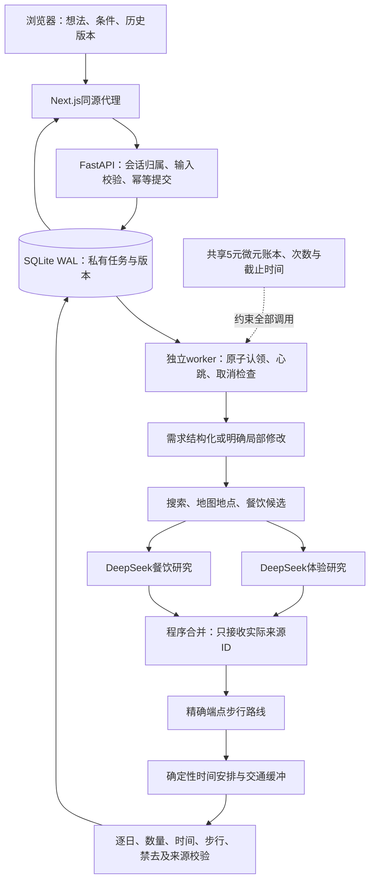

# 架构与工程边界

当前交付是本机可演示的只读规划MVP。使用Next.js、React、TypeScript、FastAPI、Pydantic、SQLite及DeepSeek。多Agent采用自建的固定分支汇合编排，没有引入LangGraph或向量数据库。

## 请求与可靠性

- **提交原子化。** SQLite事务保证同一私有会话与请求ID只创建一次。同ID换内容返回冲突；删除或到期后保留30天请求墓碑，不重新付费生成。
- **执行独占。** worker事务认领排队任务，60秒租约每10秒续期，进度与费用预留另外落盘。进程失联后标为中断，不自动重放可能已经收费的请求。不是跨供应商的恰好一次执行保证。
- **有界消耗。** 来源先行引擎最多8次模型、20次来源、180秒。账本用人民币微元原子预留，并发分支共享5元估算上限。未知用量、过期价格卡及免费配额故障停止后续调用，不自动充值或重试。
- **取消可解释。** 停止后续工作；已发出的HTTP请求可能完成并计费。进程强制结束时未结算预留仍保留未知，不能把它当零费用。
- **容量有限。** 每会话1个、全局2个活跃任务；滚动24小时20/100次；每次旅行最多32版。本机SQLite方案没有承诺高可用、横向扩容或公网抗滥用。

## AI与程序各负责什么

模型从已查询地点选择ID、日期和停留时长，餐饮分支建议关键词及实际候选ID。程序过滤不存在、重复、超范围和已排除地点，取得对应路线后排时间；步行按向上取整分钟加10分钟缓冲，不把直线距离当交通时间。必去与禁去冲突保留失败；未知营业、预约和价格继续未知。

三种策略复用同一工具和校验：串行查询后联合研究、并行工具后联合研究、并行工具后体验/餐饮双分支。联合输出上限2048 token，专精1536+512；专精重复输入且多一次请求，因此不承诺成本相同。当前默认联合研究，依据见[评测报告](EVALUATION_REPORT.md)。

明确局部修改复用本会话上一版证据。只调整指定日期，保留其他日期及活动原时长；新增相邻端点才补查路线，不调用研究模型。排除同时绑定名字与来源ID，换策略重新研究也不得绕过。当前“换掉”仅移除并提示另选，尚未自动完成替换。

## 隐私、证据与审批

浏览器持有256位随机能力凭据，HttpOnly、SameSite=Strict，后端存其哈希并逐资源授权。它是匿名私有工作区，不是注册账户；清Cookie后无法找回，不支持跨设备恢复。输入、来源片段和版本在忽略的本机SQLite保存7天；原输入与完整来源不进入公开日志。磁盘数据库未加密；主机管理员可访问。

前端只能调用同源白名单，API监听本机回环；服务间凭据不进入浏览器。公开演示资料均为合成数据。演示与真实模式不能并用，版本证据不能跨模式复用；演示通过两个MockTransport截断网络，不作为真实故障的隐式回退。

所有当前工具均只读，没有下单、预约、锁位或支付工具。人工审批是未来交易的服务端必要边界，本版不能声称已实现完整交易审批工作流。引用可定位也不证明事实真实；`facts_verified`保持false，旅行未知费用不计作零。

## 后续生产工作

正式身份、HTTPS、备份恢复、监控告警、全局账户配额、真实预发布、票务/酒店授权与账单对账仍未完成。公网部署必须重新执行[上线门禁](TESTING.md)，不能从本机测试通过推导生产可用。
