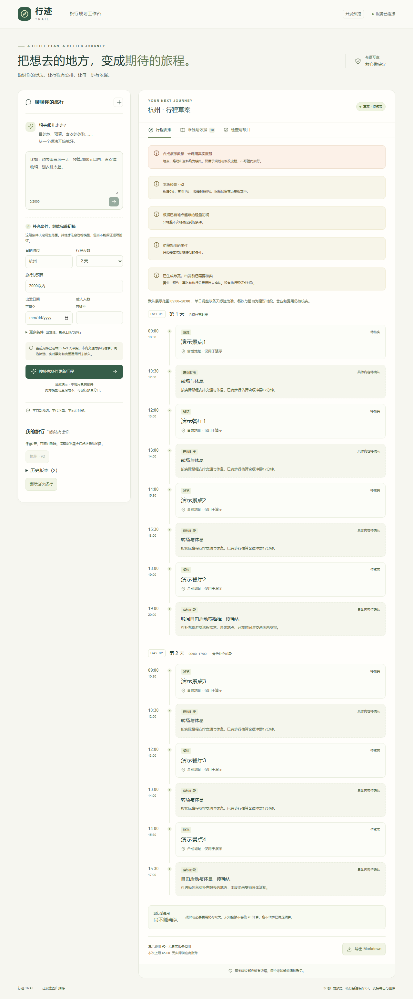

# 一键本地演示与三分钟讲解

面试展示优先打开[公网正式版](https://travel-agent-web-tau.vercel.app)，可输入南京、上海等目的城市及实际需求，不设两城白名单。线上生成真实来源行程，下面的合成启动流程保留给本机测试。[当前发布与验收](devlogs/2026-11-11-restore-real-planning.md)

演示使用明确标注的合成地点、餐厅和路线，不调用真实模型、搜索或地图。真实模式使用本地密钥和每次5元上限。两者不能混用已有旅行版本。

## 启动

Windows需要Python3.11以上、uv和Node.js24/npm。在仓库根目录执行：

```powershell
powershell -ExecutionPolicy Bypass -File scripts/demo.ps1
```

脚本安装锁定依赖、构建网页，隐藏启动Next.js、FastAPI和独立worker。首次下载依赖需要网络；演示规划本身不联网，不读取根目录`.env`。完成后打开<http://127.0.0.1:3000>。已有构建可加`-SkipBuild`。3000/8000被占用时停止启动，不擅自结束其他进程。

停止本仓库启动的服务：

```powershell
powershell -ExecutionPolicy Bypass -File scripts/stop-web.ps1
```

日志与进程记录在忽略的`artifacts/web/`，任务在`runtime/tasks.sqlite3`。停止服务不删除旅行。清理Cookie将失去私有历史访问能力；页面可删除整次旅行。

## 三分钟演示顺序

1. **先有首稿。** 输入“杭州两天，预算2000以内”，发送。展示两天的景点、午晚餐、交通缓冲和晚间留白；指出“合成演示”标识、营业/票务未知、总旅行费用未知。
2. **再改一处。** 发送“第二天下午五点结束”。第二天到17:00，第一天保持原安排。看版本差异与历史，不重新生成全部研究。
3. **解释依据。** 打开来源页和检查页。地点ID来自实际返回记录；演示来源标成合成提供者，不能当真实攻略。规则满足不等于事实已认证。
4. **证明可恢复。** 刷新仍显示当前版本。停止并重新运行演示，当前浏览器可读取已完成旅行。中断任务只提示中断，不自动再次付费。
5. **展示全栈。** 展开历史版本、切换旧版、导出Markdown；最后两次确认删除全部版本。研究策略可选专精并行；只有真实受控报告证明实际请求重叠，合成演示不证明真实性能。

完整桌面/手机截图来自实际Next.js与FastAPI联调，全部数据为合成：



[手机长图](images/mobile-demo.png)

## 真实模式

在本机被忽略的`.env`设置`DEEPSEEK_API_KEY`、`AMAP_WEB_API_KEY`及`AMAP_FREE_QUOTA_ONLY=1`。不要将密钥放进网页、仓库、截图或演示材料。参考[模型配置](DEEPSEEK.md)及[来源配置](SOURCES.md)。

```powershell
powershell -ExecutionPolicy Bypass -File scripts/stop-web.ps1
powershell -ExecutionPolicy Bypass -File scripts/start-web.ps1 -Live -Production
```

真实模式需要仍有效的价格卡与账号免费配额；卡片过期会停止，不应仅改日期绕过核价。草案没有确认实时票务、酒店库存或营业，不执行购买。当前本机演示交付不包含公网发布。

## 可选Docker文件

仓库提供`Dockerfile.api`、`Dockerfile.web`、`compose.yaml`与`.dockerignore`，只配置本机合成演示。Compose默认读取根目录`.env`用于变量插值；请用单独的本机演示变量文件，避免带入真实配置：

```powershell
$demoBytes = New-Object byte[] 32
$demoRandom = [Security.Cryptography.RandomNumberGenerator]::Create()
$demoRandom.GetBytes($demoBytes)
$demoRandom.Dispose()
$env:TRAVEL_WEB_TOKEN = [BitConverter]::ToString($demoBytes).Replace('-', '').ToLowerInvariant()
docker compose --env-file .env.demo.example up --build
```

当前主机没有Docker，容器构建及运行尚未验收；默认交付与已验证路径是上方PowerShell演示。容器API与网页共享网络命名空间，以保留固定回环代理；只有网页3000端口绑定本机，持久数据使用私有命名卷。这些文件不作为生产部署通过的证据。
